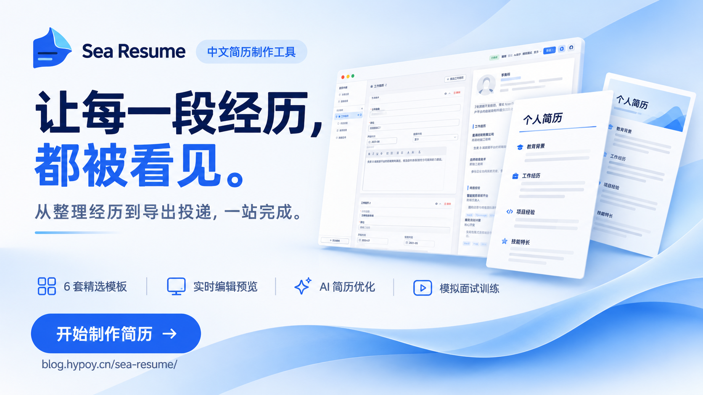
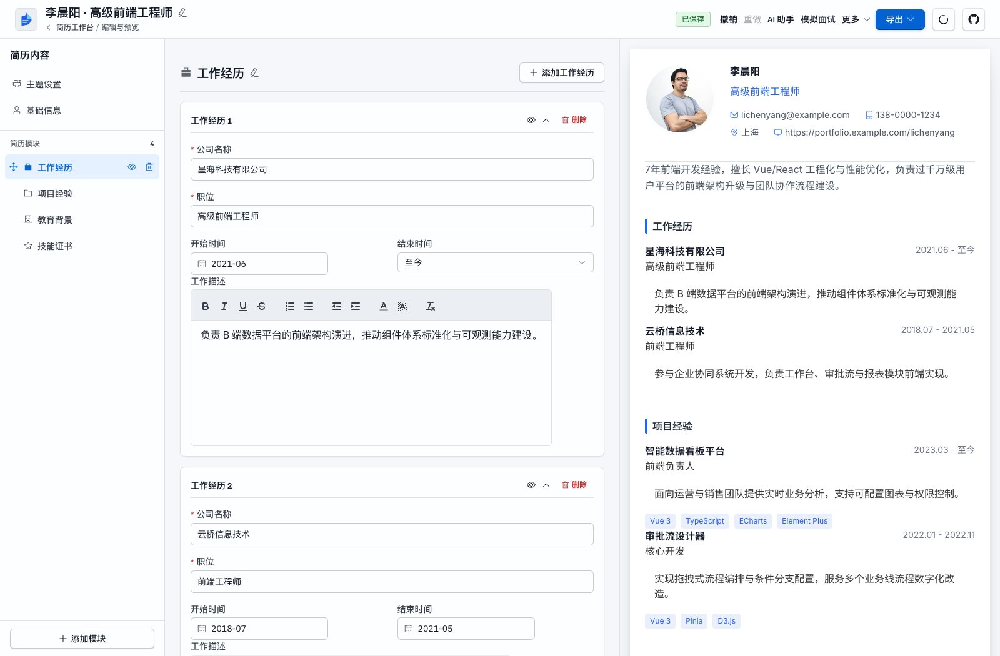
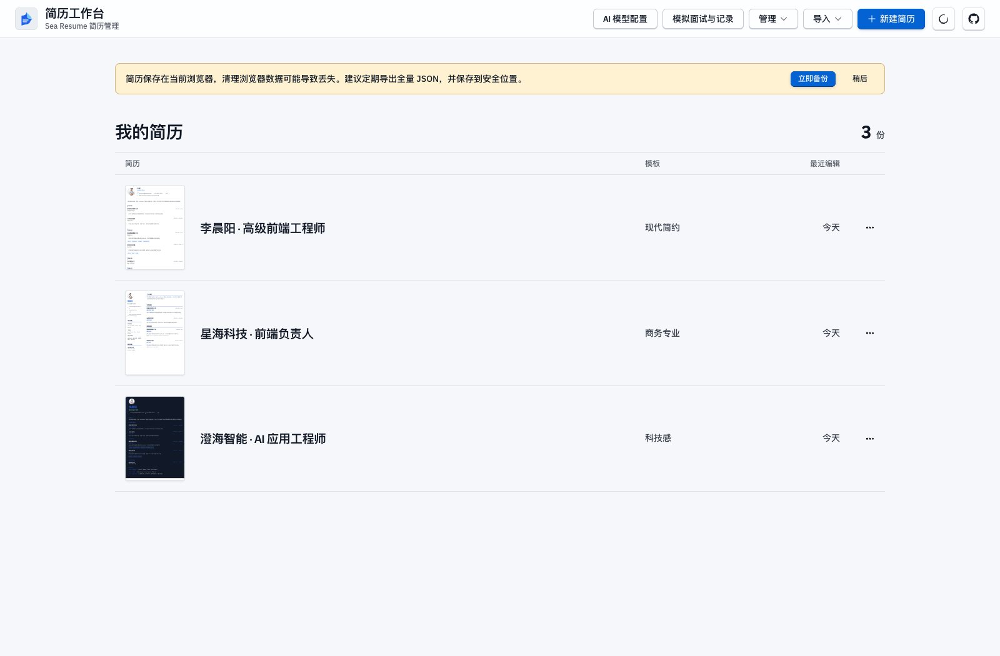
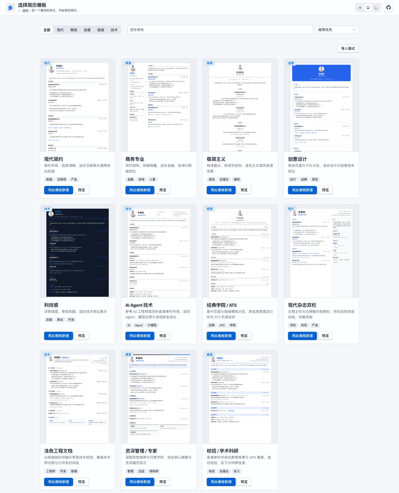
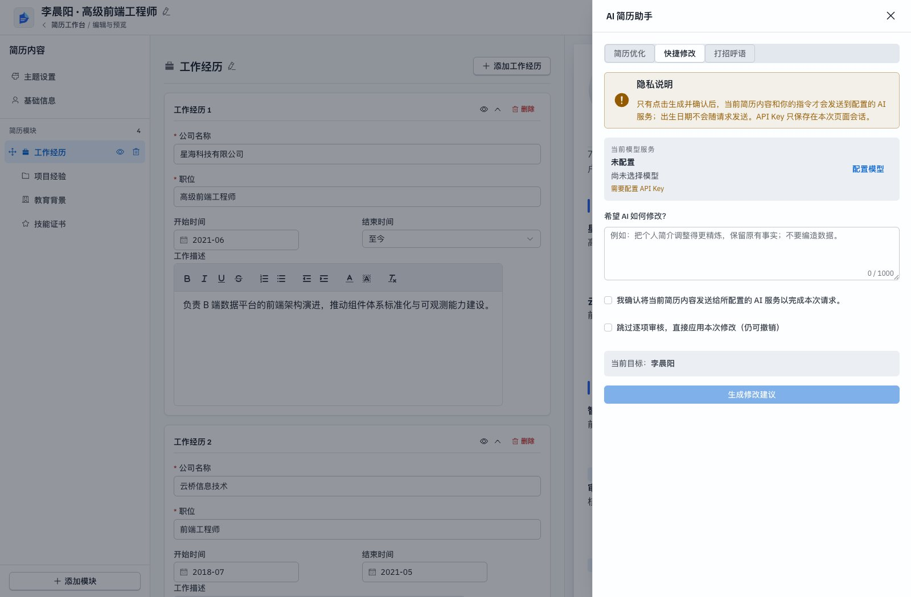
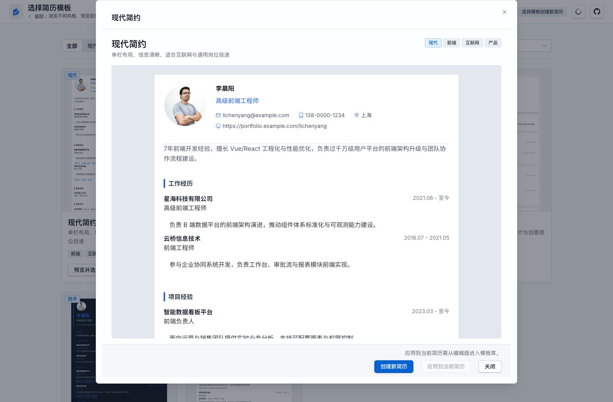
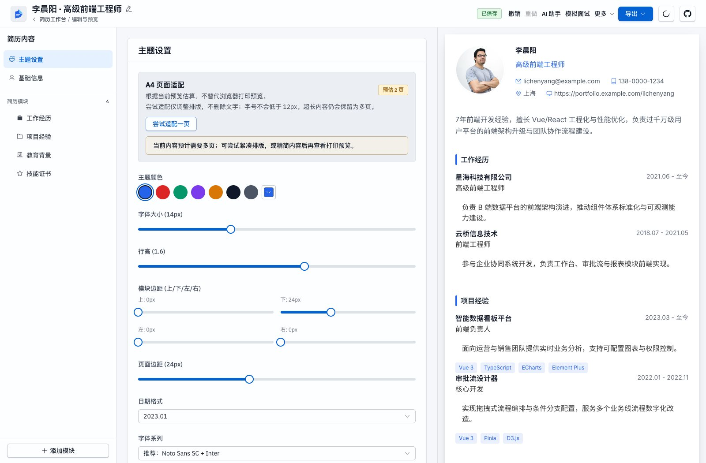
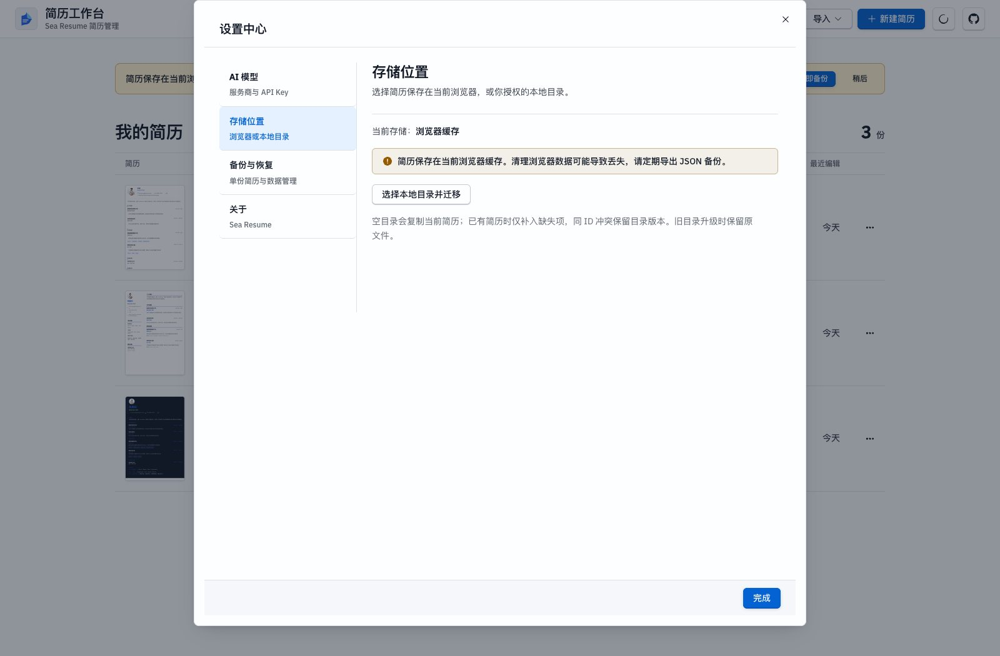

<div align="center">
  
  <h1>Sea Resume</h1>
  <p>Local-first Resume Workbench · 11 Built-in Templates · Job Version Graph · Deterministic AI Fact-Guard · Keyless External Agent (MCP)</p>
  <p>
    <a href="README.md">简体中文</a> · English
  </p>
  <p>
    <a href="https://blog.hypoy.cn/sea-resume/"><strong>Try Sea Resume Online →</strong></a>
  </p>
  <p>
    <a href="https://github.com/Theproudcold/sea-resume/releases"></a>
    <a href="LICENSE"></a>
    <a href="https://linux.do/"></a>
  </p>
</div>

[](https://blog.hypoy.cn/sea-resume/)

Sea Resume is a purely client-side resume builder and job-search workbench built with **Vue 3 + TypeScript**. From drafting experience and managing role-specific resume branches to AI-assisted refinement, mock interviews, and multi-format export, everything runs directly in the browser—no backend or account required. Core editing works out of the box without any AI configuration, with light, dark, and system theme support.

> Note: The application UI and built-in templates are currently localized in Simplified Chinese.

[Key Features](#key-features) · [Screenshots](#screenshots) · [Quick Start](#quick-start) · [Data & Privacy](#data--privacy) · [Development & Docs](#development--docs)

## Key Features

### 1. Template Gallery & Visual Editor

- **11 Built-in Templates + Custom Templates / Layouts**: Filter by category, search by keyword, sort, and preview before applying. Save any resume as a **Custom Template** (content + styling) or a **Saved Layout Recipe** (layout only, with JSON import/export).

| Template | Layout Style | Best For |
| --- | --- | --- |
| Modern (`现代简约`) | Clean single-column layout | Tech & general roles |
| Professional (`商务专业`) | Structured two-column layout | Finance, consulting & operations |
| Minimal (`极简主义`) | Generous whitespace, low visual noise | New grads & formal applications |
| Creative (`创意设计`) | Accent header & modular cards | Design, branding & creative roles |
| Tech (`科技感`) | Dark paper tone & monospace headings | Backend, systems & algorithm engineers |
| AI Agent (`AI Agent 技术`) | Compact single-column emphasizing AI/project impact | Agent, LLM application & full-stack engineers |
| Classic / ATS (`经典学院 / ATS`) | Centered serif header, crisp hairlines, dense single column | Big tech, consulting, finance & ATS screening |
| Editorial (`现代杂志双栏`) | Left primary column with warm light-gray right sidebar | Product, UX, growth & modern tech roles |
| Clean Engineer (`浅色工程文档`) | Print-friendly light paper, timeline rail & mono stack chips | Frontend, backend, full-stack & DevOps |
| Executive (`资深管理 / 专家`) | Dual-tone top bar, highlighted executive summary & clear hierarchy | Senior specialists, architects & leaders |
| Campus / Academic (`校招 / 学术科研`) | Compact single column spotlighting education & GPA badge | Graduates, interns, research & academia |

- **Resizable 3-Pane Workspace & A4-First Preview**: Drag dividers or toggle visibility for the section nav, editor, and live A4 preview (preferences persist per browser). Includes drag-and-drop section ordering, custom sections, rich-text editing, interactive avatar cropping (circle/square), and 7 contact icon styles.
- **Smart One-Page Fit & Content-Aware Pagination**: Measures exact A4 page count on the live canvas. **Fit to One Page** progressively tightens margins, spacing, and font size down to a readable floor without deleting content. Page breaks always land in gaps between content bands so exported PDFs and images never slice through text lines.
- **Editing Safeguards**: Auto-save with retry, undo/redo, keyboard shortcuts, one-click **Privacy Mask** for safe screen-sharing, and deterministic **Quality Checks** for missing basics and invalid date ranges.

### 2. Job-Tailored Versioning & Version Graph

- **Master Track & Role Branches**: Increment version numbers along a master track (e.g. `v2`) and derive tailored branches for specific companies or roles instead of juggling duplicate files.
- **Git-Style Version Graph**: Continuous SVG rails visualize master commits, role branch forks, and rebase/sync merges at a glance.
- **Diff & Sync from Master**: Compare any two versions section by section, cherry-pick changes into a new version, and detect when a role branch falls behind master—then selectively sync new master content without overwriting role-specific wording.
- **Per-Resume Version History (Git-Style Timeline)**: Open **History** in the editor toolbar or **Version History** from a workbench card to inspect commit timelines, working-tree vs. `HEAD` line diffs, manual commits, tags, and append-only restores. Automatic checkpoints run on leaving the editor, every 10 minutes, on page close, and around AI apply/reset; local-folder storage mirrors history to `.history/`, and full backups optionally include the latest 50 commits per resume.

### 3. AI Job-Search Loop & Local Guardrails

The editor's **AI Assistant** provides five modes, paired with a dedicated **Mock Interview** workspace:

- **Resume Optimization (3-Role Pipeline)**: Role gap analysis & factual follow-up questions → grounded rewrite → review grading (Approve / Confirm / Reject), applied item by item to a derived job version by default.
- **Deterministic Fact-Guard**: Every AI suggestion runs through a model-free deterministic validator that rejects fabricated metrics (recognizing numeric equivalents like `10k`/`10000` and exempting tech identifiers like `P99`/`H800`), swapped metric subjects, invented contact info, unrequested translation, or broken structure. Rejected suggestions cannot be overridden by model review or history restore.
- **JD Risk Scanner (100% Local, Zero API Calls)**: Paste a job description to highlight 8 common red-flag categories (overtime intensity, on-call coverage, unclear scope, business maturity, compensation ambiguity, outsourcing/dispatch, authority buzzwords, conditional promises) with plain-language explanations and interview counter-questions—excluding negation and requirement-management contexts. Works with zero AI setup.
- **STAR Polish / Quick Edit / Cold-Outreach Greetings**: STAR polish restructures selected entries without inventing outcomes; Quick Edit supports diff approval, direct apply, and one-click undo; Greeting generator drafts editable messages from a JD.
- **Mock Interviews & Practice Analytics**: Choose **Coaching Mode** (per-question feedback) or **Realistic Mode** (end-of-session report) with bounded follow-ups, local timers, draft persistence, cross-session recurring weakness tracking, targeted weak-spot drills, and user-confirmed **fact backfill** back into your resume.

### 4. Three Ways to Connect AI (Including Keyless MCP)

1. **Cloud OpenAI-Compatible APIs**: OpenAI, DeepSeek, Qwen, or custom endpoints—configured once in Settings and shared across features.
2. **Local Models**: Connect directly to **Ollama** or **LM Studio** over loopback without authentication, with configurable JSON compatibility mode and timeout.
3. **External Agents (No Website API Key Required)**:
   - **MCP Bridge (Recommended)**: Bundles a standalone `relay.mjs` at build time. Enable it from **External AI** to get copy-paste commands or config snippets (macOS / Linux / Windows) for **Codex (CLI / VS Code extension), Claude Code (CLI / VS Code extension), Generic MCP JSON (Antigravity / Cursor / Windsurf / Claude Desktop / Cline / Roo Code, etc.), Pi, ZCode, DeepSeek Harness, OpenCode, Gemini CLI, Qwen Code, Amp, Copilot CLI, Crush, and Goose**. Once connected, your external agent can list/read/write resumes, derive role branches, open the live visual preview, run local quality and JD risk checks, export PDFs, save mock interview reports, and **handle web AI Assistant & text-PDF import tasks with zero website API keys**.
   - **Sanitized File Exchange (No MCP Needed)**: Export a redacted ZIP workspace from the editor, let any local CLI write a JSON edit proposal, and review/apply diffs back in the browser.

### 5. Multi-Format Import/Export & Local-First Storage

- **Export**: WYSIWYG PDF, independently typeset searchable PDF (with bundled Noto Sans SC subset), PNG images (multi-page zipped automatically), Markdown, JSON backup, and browser print.
- **Import**: Markdown, JSON single/full backups, and **PDF Import** via either local **Text Extraction** or multimodal **Vision Recognition**, with interactive review before saving.
- **Storage & Cloud Drive Sync**: Stores data in the browser by default, or in an authorized **Local Folder** (File System Access API). Point the local folder at a cloud drive sync directory (e.g. OneDrive, iCloud Drive, Nutstore) for account-free multi-device sync. Includes versioned full backups with non-destructive conflict restoration.

## Screenshots

### Visual Editor & Live A4 Preview



### Workbench & Version Management



### Template Gallery



### AI Resume Assistant



<details>
<summary>More screenshots (Template Preview, Section Manager, Theme & One-Page Fit, Storage Settings)</summary>

#### Template Preview


#### Section Manager


#### Theme Settings & A4 One-Page Fit


#### Storage Settings & Backup


</details>

## Quick Start

### Prerequisites

- Node.js `>= 22.13.0`
- pnpm

### Run Locally

```sh
pnpm install
pnpm dev
```

Open the local URL printed in the terminal (default: `http://localhost:3000`).

### Scripts

| Command | Description |
| --- | --- |
| `pnpm dev` | Start the Vite development server |
| `pnpm build` | Run TypeScript / Vue type-checking and build production assets |
| `pnpm preview` | Preview the production `dist/` build locally |
| `pnpm test` | Run the Vitest test suite |
| `pnpm test:watch` | Run tests in watch mode |
| `pnpm verify` | Run full tests, type-checking, and production build sequentially |

### Static Deployment

Production files are emitted to `dist/` (including the bundled standalone `ai-relay/relay.mjs`). Because the app uses Vue Router history mode, configure your static host to fall back unmatched routes to `index.html` (handled automatically via `404.html` on GitHub Pages; subpath deployments can set `VITE_BASE_PATH`).

## Data & Privacy

- **100% Client-Side**: Your resumes live only in your browser or a local folder you explicitly authorize—never on a Sea Resume backend.
- **Non-Destructive Restore**: Single-resume JSON and full-backup restores validate schemas and check for ID/name collisions first, creating separate copies instead of overwriting existing resumes.
- **API Key Handling**: Keys stay in page memory by default and clear on refresh. Only when you explicitly opt in to "Remember key on this device" per provider is a key saved in local browser storage. Keys are never included in config exports or resume backups.
- **AI Transmission Boundaries**: Requests are only sent after explicit user action and consent. Hidden sections and structured identity/contact fields are excluded by default (date of birth is never sent by the AI Assistant). PDF import never uploads the raw PDF file—only locally extracted text or rendered page images.
- **External Agent Security**: File exchange exports only sanitized visible body text and requires manual diff approval. The optional MCP relay binds strictly to `127.0.0.1` with an exact `--widget-origin` check, operates on your local browser resume library, and disconnects immediately when you stop the bridge.

## Development & Docs

### Tech Stack

- **Core**: Vue 3, TypeScript, Pinia, Vue Router
- **UI & Editing**: Element Plus, Tailwind CSS, SCSS, vuedraggable, Vue Quill
- **Import / Export**: html2canvas, jsPDF, pdfmake (bundled Noto Sans SC subset), fontkit, PDF.js, fflate
- **AI & Tooling**: `@mcp-b/webmcp-polyfill` & `webmcp-local-relay` (single-file bundle), Vite (`rolldown-vite`), Vitest, idb

### Project Structure

```text
src/
├── views/                 # Workbench, Template Gallery, Editor, Mock Interview & History
├── components/            # Section editors, preview templates, AI panels, version graph
├── stores/                # Resume, template, workbench, storage, AI & interview stores
├── services/
│   ├── ai/                # Provider config, job-search pipeline, PDF import, MCP bridge & task queue
│   ├── storage/           # Browser & local filesystem storage adapters
│   └── templates/         # Local custom resume templates & layout recipe storage
├── utils/                 # Export, backup, pagination, fact-guard, JD risk lexicon, version graph
│   ├── markdown/          # Markdown import/export & sanitization
│   └── pdf/               # Searchable PDF layout & font subsetting
└── types/                 # Resume, template, storage & AI type definitions
build/                     # Build-time single-file ai-relay bundler & version injection plugin
tools/                     # Offline/source ai-relay launcher & release tagging script
docs/                      # Architecture, AI design, external agent guide, UI guidelines & assets
```

### Further Reading (Chinese)

- [Architecture & Invariants](docs/architecture.md) — Data flow, save ordering, pagination authority, and implicit contracts
- [AI Job-Search Assistant Design](docs/ai-feature-design.md) — 3-role optimization, deterministic fact-guard, JD risk scanner & mock interviews
- [Local Models & External AI Integration](docs/local-and-external-ai.md) — Ollama / LM Studio, file exchange, MCP tool list & security boundaries
- [UI & Interaction Guidelines](docs/ui-guidelines.md) — Design tokens, dialogs, destructive actions & responsive conventions
- [Contributing Guide](CONTRIBUTING.md) — Branching model, commit conventions, PR checklist & release flow
- [Changelog](CHANGELOG.md) — Release history and detailed changes

## License

Released under the [MIT License](LICENSE).
