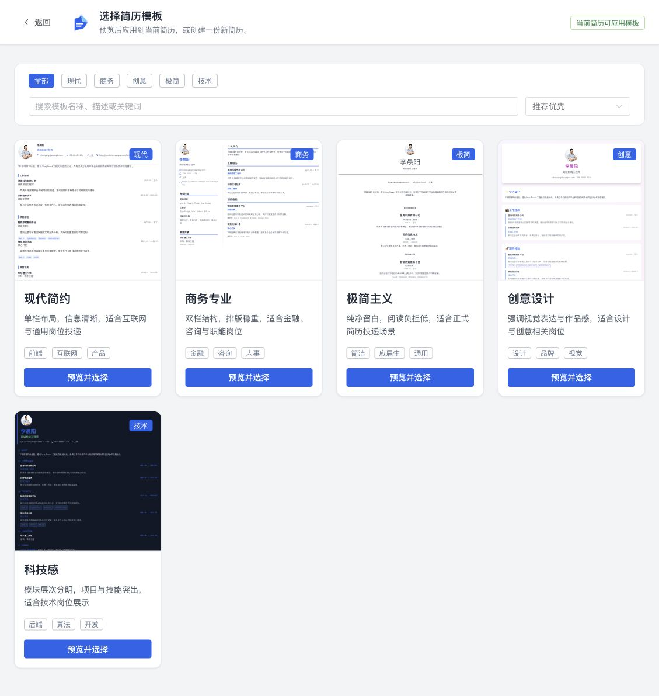
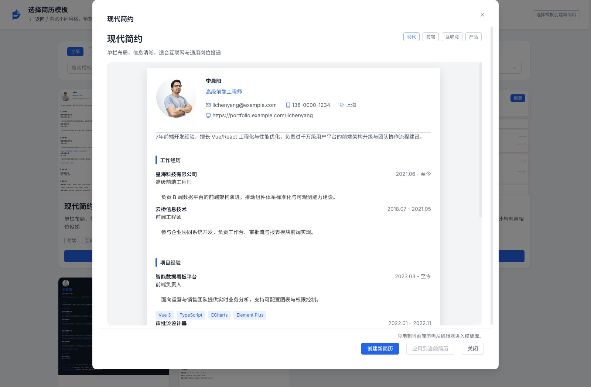
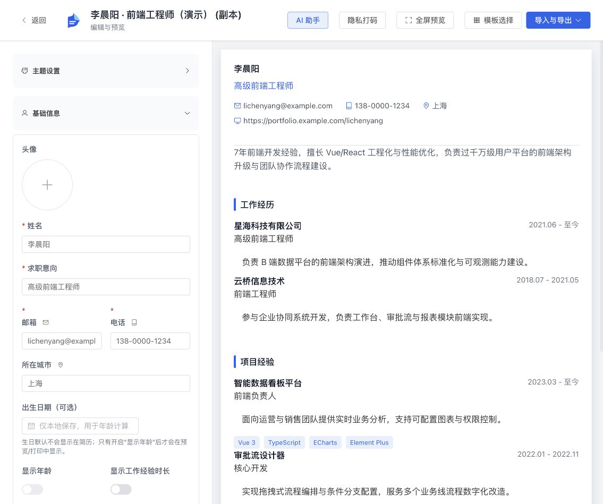
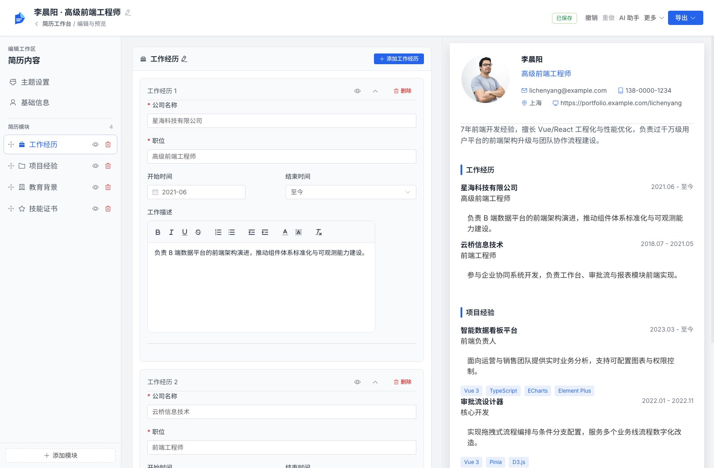
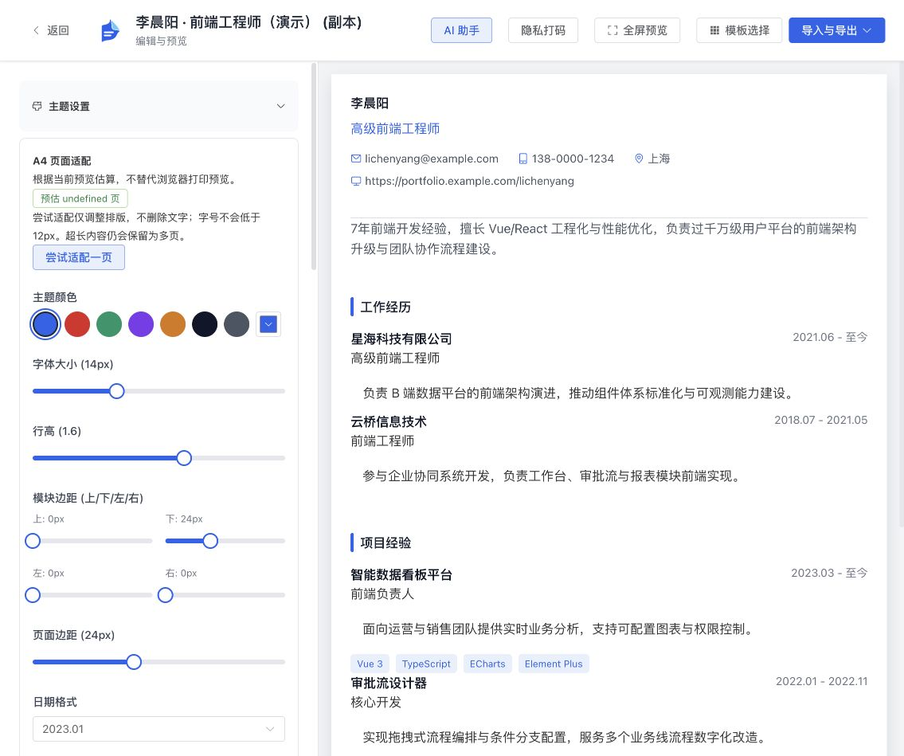
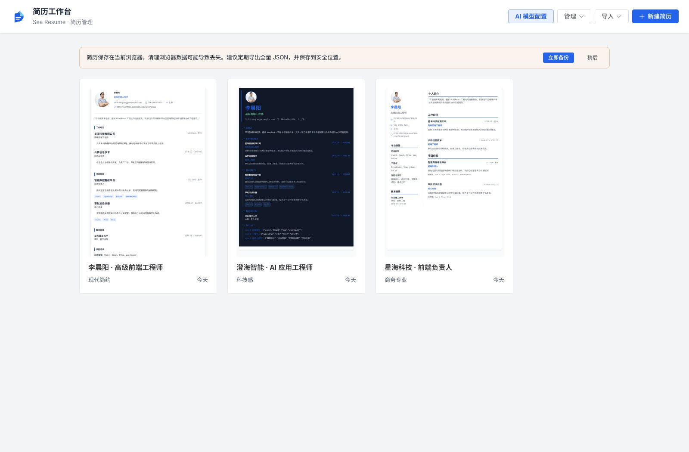
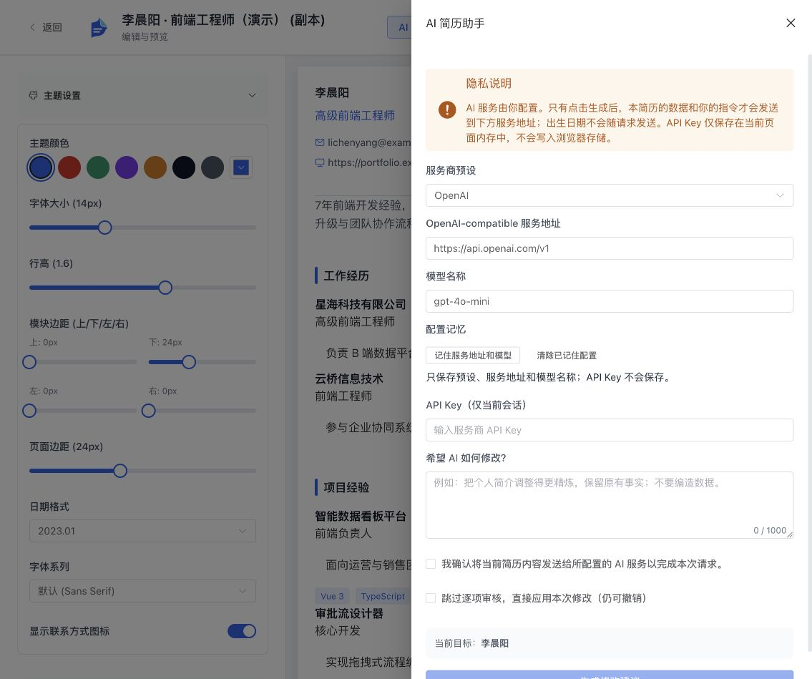
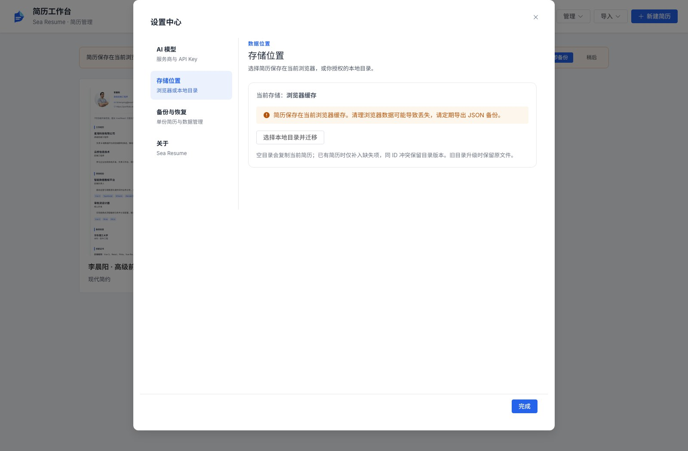

<div align="center">
  
  <h1>Sea Resume</h1>
  <p>中文简历制作工具 · 6 套模板 · 实时预览 · 岗位版本管理 · AI 辅助</p>
  <p>从整理经历到导出投递文件，在一个工作台里完成。</p>
  <p><a href="https://blog.hypoy.cn/sea-resume/"><strong>在线体验 Sea Resume →</strong></a></p>
</div>

Sea Resume 基于 Vue 3 与 TypeScript 构建，支持管理多份简历、按岗位创建独立版本、编辑内容与主题，并导入导出多种文件格式。基础编辑功能无需配置 AI 服务即可使用。

[界面预览](#界面预览) · [功能一览](#功能一览) · [快速开始](#快速开始) · [数据与存储](#数据与存储) · [开发与验证](#开发与验证)

## 界面预览

以下界面截图于 2026-10-11 截取，用于展示当前主要页面流程；功能细节以当前界面为准。

### 模板库：先看效果，再选风格

模板库支持按现代、商务、创意、极简、技术分类筛选，配合关键词搜索和排序查找模板。点击卡片上的 **预览并选择** 查看大图；从编辑器进入时，页面会提示 **当前简历可应用模板**。



| 模板 | 排版特点 | 适用场景 |
| --- | --- | --- |
| 现代简约 | 单栏布局，信息清晰 | 互联网与通用岗位 |
| 商务专业 | 双栏结构，排版稳重 | 金融、咨询与职能岗位 |
| 极简主义 | 纯净留白，阅读负担低 | 应届生与正式投递 |
| 创意设计 | 强调视觉表达与作品感 | 设计、品牌与创意岗位 |
| 科技感 | 模块层次分明，突出项目与技能 | 开发、后端与算法岗位 |
| AI Agent 技术 | 紧凑单栏，突出 AI 工程与项目经历 | Agent、大模型应用与全栈研发岗位 |

点击预览弹窗底部的 **创建新简历** 新建一份简历，或点击 **应用到当前简历** 切换正在编辑的简历样式。



### 编辑器：左侧编辑，右侧预览

顶部提供 **AI 助手、撤销 / 重做、隐私打码、质量检查、全屏预览、模板选择、导入与导出**。左侧编辑个人资料和各类经历，右侧实时查看 A4 排版；窄屏下通过 **编辑 / 预览** 切换视图。



### 章节管理：折叠内容，整理重点

**主题设置** 和 **基础信息** 可分别展开。下方 **模块排序与内容** 区域支持拖动章节排序、修改模块名称、显示或隐藏模块，以及展开或折叠章节。点击 **添加模块** 可添加已有模块或创建自定义模块。



### 主题设置：直接调整简历排版

通过色板或颜色选择器调整主题色，使用滑块修改字号、行高、模块边距和页面边距；还可选择日期格式、字体系列，并切换联系方式图标。

**A4 页面适配** 面板显示可测量画布的页数估算，并提供 **尝试适配一页**。适配只调整排版、字号不低于 12px，不会删除简历内容；可还原原排版。页数会随内容和主题更新，最终分页以 PDF 或打印预览为准。



### 工作台：集中管理不同版本

为不同岗位维护独立简历，支持复制、重命名和删除；也可以从 Markdown 或已有 PDF 开始整理。**岗位版本与比较** 可查看版本历史、比较内容差异，并将选中的改动另存为新简历。



### AI 助手：按需求生成修改建议

可添加多个 AI 服务配置，使用 OpenAI、DeepSeek、通义千问、自定义 OpenAI-compatible 接口，或 Ollama / LM Studio 本机服务。本机服务可无 API Key，支持 JSON 兼容模式和超时设置；线上失败不自动切换服务。描述修改目标后审核建议、选择应用；最近一批 AI 修改可撤销。



### AI 求职闭环：优化简历，再练习面试

编辑器 **AI 助手 → 简历优化** 提供岗位分析、事实补充、自然表达改写与审查，逐条采纳并默认另存岗位版本。**模拟面试与记录** 支持文字训练 / 真实模拟、根据回答追问、报告与用户确认后的简历回补。沿用纯前端与自带 API Key；同模型多角色不是独立事实核验，不提供所谓 AI 率检测。

详细流程、DeepSeek 式对话交互与有界 Loop / 项目深挖的设计边界见 [AI 求职助手](docs/ai-feature-design.md)。

### Codex CLI / Claude Code 与本地 AI

编辑器 **更多 → 外部 AI** 支持下载脱敏工作区、导入 JSON 修改草稿，以及可选的开源 MCP 实时桥接。外部 Agent 只能提交建议，由用户在网页核对差异后保存，包含版本冲突检查与撤销。网站保持纯前端，MCP 需要额外的本机启动包；不使用 MCP 时无需安装。

配置、协议、安全边界和开源方案取舍见 [本地模型与外部 AI 接入](docs/local-and-external-ai.md)。

## 功能一览

| 能力 | 支持内容 |
| --- | --- |
| 简历管理 | 创建、复制、重命名、删除；创建岗位定制副本并记录公司 / 岗位及来源 |
| 模板选择 | 六种模板、分类筛选、搜索、排序、预览与切换 |
| 内容编辑 | 个人资料、自定义联系方式、富文本描述、工作经历、项目、教育、技能和自定义章节 |
| 章节管理 | 快速跳转、拖动排序、标题编辑、展开 / 折叠、显示 / 隐藏、添加 / 移除 |
| 版本比较 | 按章节查看新增、修改和删除；搜索与筛选差异，选择性采纳并另存为新简历 |
| 质量检查 | 确定性检查基础信息、内容完整度和可识别的日期范围异常，可跳转编辑 |
| 编辑恢复 | 自动保存、保存失败重试、撤销 / 重做及键盘快捷键 |
| 排版与预览 | 主题设置、A4 页数估算、一页适配、隐私打码、全屏预览及打印 |
| 导出 | 与预览一致的 PDF、独立排版的可搜索 PDF、图片、JSON、Markdown；多页图片打包为 ZIP |
| 内容导入 | Markdown、JSON 副本；AI 辅助解析可复制文本的 PDF，并在创建前校对 |
| 数据与备份 | 浏览器或授权本地目录存储；单份与全量备份、校验及非覆盖恢复 |
| AI 能力 | 多服务商配置、模型列表读取、审核式简历修改与 PDF 内容解析 |
| AI 求职闭环 | 三角色简历优化、文字训练 / 真实面试、动态追问、报告与事实回补 |

## 快速开始

准备 Node.js 22.13+ 和 pnpm，在项目目录执行：

```sh
pnpm install
pnpm dev
```

打开终端输出的本地地址，默认是 `http://localhost:3000`；端口被占用时以实际输出为准。

1. 在工作台点击 **新建简历**，浏览并预览六种模板，创建一份简历。
2. 在编辑器填写基础信息，逐步添加经历、项目、教育和技能；用章节快速跳转整理内容。
3. 使用 **质量检查** 查看待补充项目；修改内容后可撤销 / 重做，顶部会显示保存状态，失败时可重试。
4. 在 **主题设置** 查看 A4 页数估算，必要时尝试一页适配。导出时可选 **与预览一致的 PDF**（按预览渲染，文字不可搜索）、**可搜索 PDF**（依据简历数据独立排版）或打印预览。
5. 在工作台打开 **岗位版本与比较**，创建记录公司 / 岗位的独立副本；比较两份简历时可搜索和筛选变化，选择性采纳版本 B 的改动并另存为新简历。该操作不会修改原版本；模板、配色和排版不计入内容差异。
6. 使用工作台 **全量备份** 导出当前存储位置的全部简历。恢复前会列出 ID / 名称冲突；冲突项以新 ID 创建副本，不覆盖已有内容。单份 JSON 恢复同样会创建副本。
7. 需要 AI 辅助时，在工作台 **AI 模型配置** 添加线上服务并填写会话 API Key，或选择 Ollama / LM Studio 本机无鉴权服务；编辑器助手与 PDF 导入共用配置。

已有内容可从工作台 **导入 Markdown** 或 **AI 导入 PDF** 开始。PDF 文本先在浏览器本地提取；可校对基础信息、经历、项目、教育和技能后创建新简历。仅在勾选同意并点击解析后，提取出的文本和文件名才会发送给所配置的 AI 服务。

## 数据与存储

工作台 **设置** 管理存储位置和单份简历备份；工作台顶部的 **全量备份** 可导出或恢复当前存储位置的所有简历。



- **浏览器存储**：默认将简历保存在当前浏览器中。清理站点数据可能导致简历丢失，建议定期使用全量备份并将文件保存在安全位置。
- **本地目录**：在工作台的 **设置** 中选择并授权目录。空目录会复制当前简历；已有 Sea Resume 数据的目录可增量合并，同 ID 冲突保留目录中的版本。该功能依赖浏览器的 File System Access API；入口是否可用以当前浏览器检测结果为准。
- **单份 JSON 恢复**：导入后创建简历副本，不覆盖已有数据。
- **全量备份恢复**：备份带格式版本信息，恢复前先验证文件并显示待导入数量及 ID / 名称冲突；冲突项以新 ID 和独立名称创建副本，绝不覆盖现有简历。浏览器会在从未备份或距上次全量备份满 30 天时提醒；备份时间戳保存在当前浏览器。
- **PDF 导入**：支持可复制文本的 PDF，最大 15 MB、最多 30 页；扫描图片 PDF 暂不支持 OCR。原 PDF 不上传；用户明确勾选同意并发起解析后，仅提取文本和文件名会发送给所配置的 AI 服务，确认创建前可校正识别内容。
- **AI 服务配置**：服务商、地址、模型与启用状态保存在当前浏览器；API Key 仅保存在页面会话内存，刷新或关闭页面后需重新输入。配置文件不包含 API Key。
- **AI 请求**：仅在用户主动发起并确认的操作中向所配置的服务发送内容。出生日期不会随 AI 助手请求发送。
- **AI 工作记录**：选择保存到本机后才写入独立浏览器数据库，不含 API Key、不随简历目录迁移，也不纳入全量简历备份；支持面试 JSON / Markdown 导出和记录删除。新优化 / 面试默认排除隐藏内容及结构化联系方式，正文中的敏感信息仍需发送前检查。
- **外部 AI**：默认关闭，仅授权当前可见正文；不共享结构化身份／联系方式、头像、隐藏条目或面试历史。正文中的隐私需人工检查。授权30分钟，关闭面板或刷新即撤销；CLI 本机运行不等于模型离线。

## 开发与验证

| 命令 | 用途 |
| --- | --- |
| `pnpm dev` | 启动 Vite 开发服务器 |
| `pnpm build` | 执行 Vue / TypeScript 类型检查并构建生产资源 |
| `pnpm preview` | 本地预览生产构建 |
| `pnpm test` | 执行 Vitest 测试 |
| `pnpm test:watch` | 以监听模式运行测试 |

```sh
pnpm build
pnpm test
```

技术栈：**Vue 3、TypeScript、Pinia、Vue Router、Element Plus、Tailwind CSS、SCSS、Vite、Vitest**。与预览一致的 PDF 和图片导出使用 html2canvas / jsPDF；可搜索 PDF 使用 pdfmake；PDF 文本提取使用 PDF.js；多页图片归档使用 fflate。可搜索 PDF 使用项目内置的 Noto Sans SC 字体。

```text
src/
├── views/                 # 工作台、模板库、编辑器
├── components/            # 内容编辑、模板预览与通用组件
├── stores/                # 简历、模板、工作台与存储状态
├── services/ai/           # AI 服务、配置与 PDF 导入
├── services/storage/      # 浏览器与本地文件系统存储
├── utils/                 # 导出、备份与通用数据处理
│   ├── markdown/          # Markdown 导入、导出与安全转换
│   └── pdf/               # 可搜索 PDF 定义与模板排版
└── types/                 # 简历、存储与 AI 类型定义
docs/
├── images/                # README 界面截图
└── ui-guidelines.md       # 应用界面样式与交互约定
```

生产构建输出到 `dist/`。项目使用 Vue Router 的 history 模式，部署到静态服务器时需将应用路由回退到 `index.html`，保证刷新编辑器和模板库页面时正常加载。

## 样式与交互约定

全站界面 token、头部、表单、弹层、危险操作和响应式规范见 [UI 设计与交互规范](docs/ui-guidelines.md)。应用界面与六种 A4 简历模板分别维护；模板排版和用户主题由各模板及简历数据负责，不套用应用界面的全局重置。
