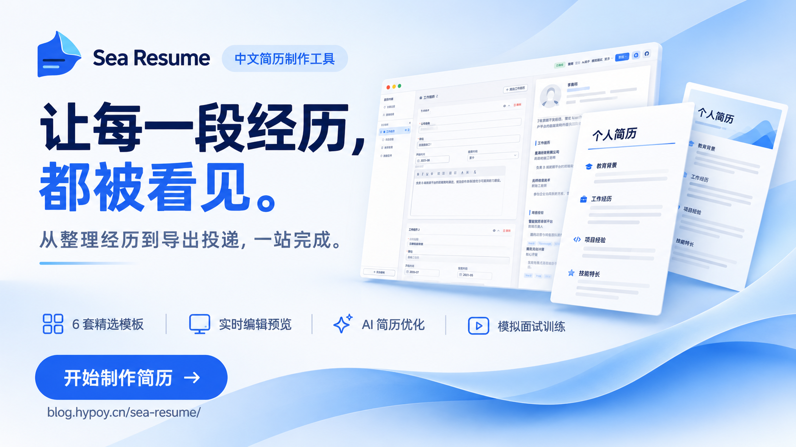
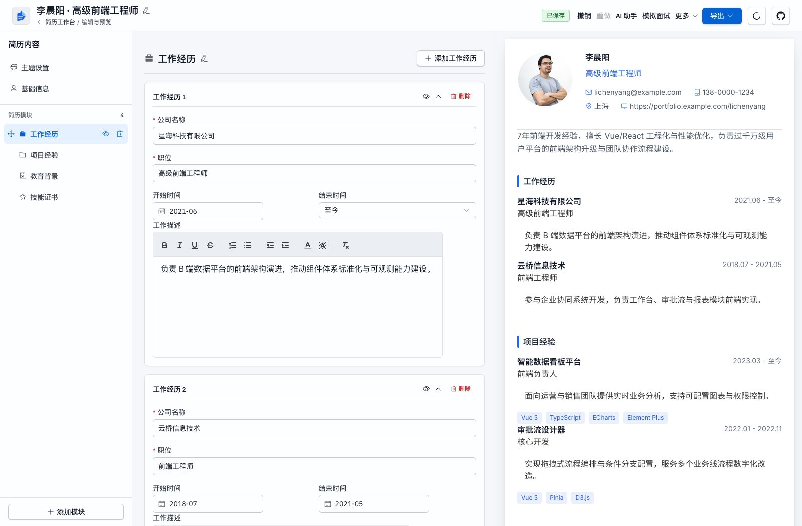
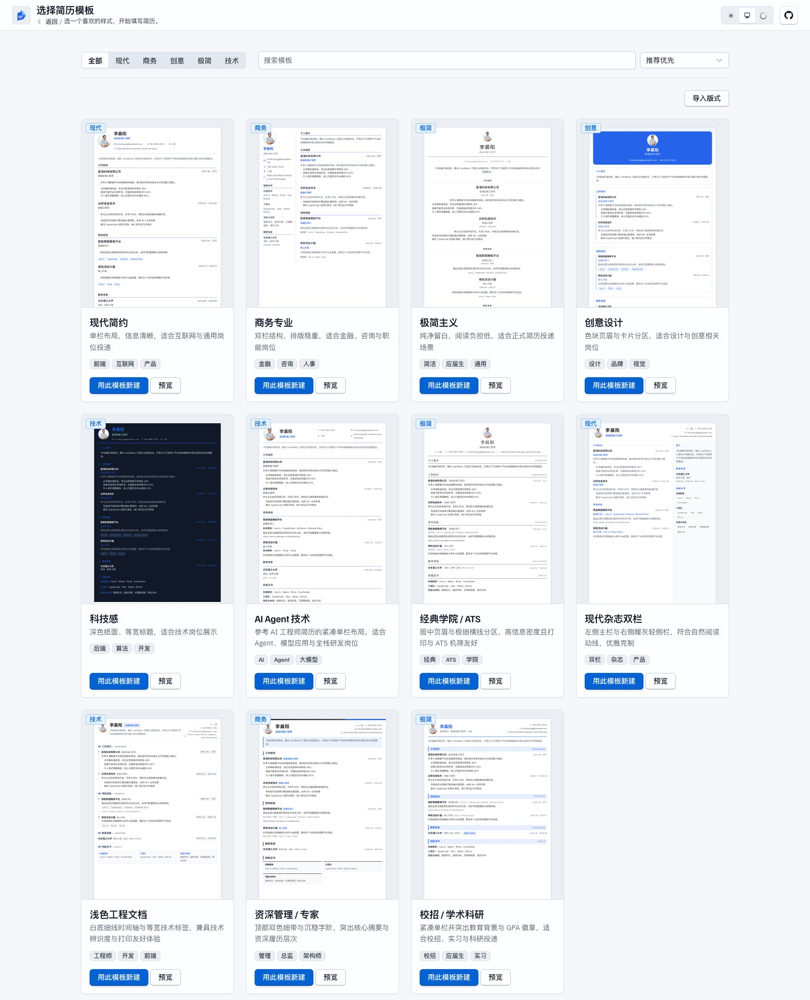
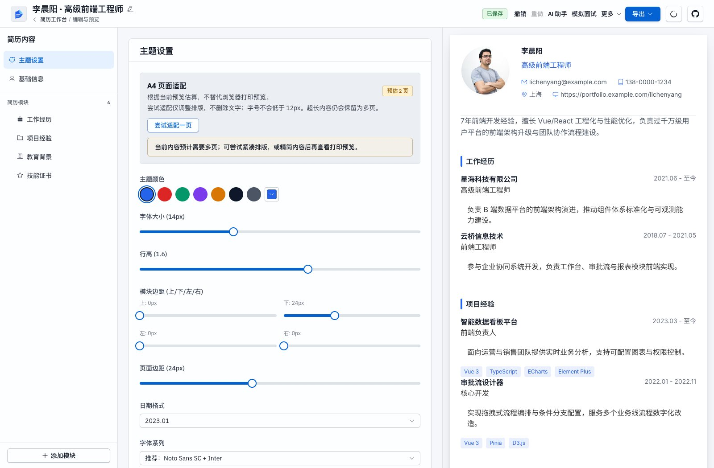

<div align="center">
  
  <h1>Sea Resume</h1>
  <p>纯前端简历工作台 · 11 套内置模板 · 岗位版本图谱 · 确定性事实校验 AI · 免 API Key 外部 Agent（MCP）</p>
  <p>
    简体中文 · <a href="README.en.md">English</a>
  </p>
  <p>
    <a href="https://blog.hypoy.cn/sea-resume/"><strong>在线体验 Sea Resume →</strong></a>
  </p>
  <p>
    <a href="https://github.com/Theproudcold/sea-resume/releases"></a>
    <a href="LICENSE"></a>
    <a href="https://linux.do/"></a>
  </p>
</div>

[](https://blog.hypoy.cn/sea-resume/)

Sea Resume 是一款基于 **Vue 3 + TypeScript** 构建的纯前端简历制作与求职辅助工作台。从整理经历、管理多岗位版本，到 AI 简历优化、模拟面试与多格式导出，全程在浏览器内完成，无需后端账号，基础编辑不依赖任何 AI 配置，支持浅色、深色与跟随系统主题。

[核心特性](#核心特性) · [界面预览](#界面预览) · [快速开始](#快速开始) · [数据与隐私](#数据与隐私) · [开发与文档](#开发与文档)

## 核心特性

### 1. 模板库与可视化编辑

- **11 套内置模板 + 自定义模板 / 版式**：支持按分类筛选、关键词搜索、排序与实时预览；可将当前简历**存为模板**（保留内容与排版）或**存为版式**（仅保存排版配方，支持 JSON 导入导出）。

| 模板 | 排版特点 | 适用场景 |
| --- | --- | --- |
| 现代简约 | 单栏布局，信息清晰 | 互联网与通用岗位 |
| 商务专业 | 双栏结构，排版稳重 | 金融、咨询与职能岗位 |
| 极简主义 | 纯净留白，阅读负担低 | 应届生与正式投递 |
| 创意设计 | 色块页眉与卡片分区 | 设计、品牌与创意岗位 |
| 科技感 | 深色纸面、等宽标题 | 开发、后端与算法岗位 |
| AI Agent 技术 | 紧凑单栏，突出 AI 工程与项目经历 | Agent、大模型应用与全栈研发岗位 |
| 经典学院 / ATS | 居中页眉、极细横线、高信息密度 | 大厂、外企、投行咨询与 ATS 机筛 |
| 现代杂志双栏 | 左侧主栏 + 右侧暖灰轻侧栏 | 产品、UX、运营与现代技术岗位 |
| 浅色工程文档 | 白底时间轴 + 等宽技术栈标签 | 前后端、全栈与打印友好工程岗位 |
| 资深管理 / 专家 | 顶部双色细带 + 沉稳字阶与核心摘要 | 5 年+ 专家、架构师与技术/业务管理 |
| 校招 / 学术科研 | 紧凑单栏，突出教育背景与 GPA 徽章 | 应届生、实习生、硕博与科研投递 |

- **三栏可调与 A4 优先预览**：左侧模块导航、中间编辑区、右侧 A4 实时预览均支持拖拽调宽与独立显隐，偏好按浏览器记忆；支持章节拖动排序、自定义模块、富文本编辑、头像裁剪（圆形/方形）与 7 种联系方式图标。
- **智能一页适配与无截断分页**：主题面板实时显示画布实测 A4 页数，**尝试适配一页**会在不删内容、不低于最小字号的前提下逐档收紧边距与行距；破页线按内容空隙计算，导出 PDF / 图片不会将文字行拦腰切断。
- **编辑保障**：自动保存、撤销 / 重做、快捷键、一键**隐私打码**（隐藏敏感信息方便截屏分享），以及确定性**质量检查**（核验基础信息完整度与日期范围异常并定位修复）。

### 2. 岗位版本管理与版本图谱

- **主干与岗位分支**：为主干简历递增版本号（如 `主干 v2`），按公司 / 岗位派生独立定制版本，不再靠复制一堆同名文件管理投递。
- **Git 风格版本图谱**：用连续 SVG 轨道直观展示主干推进、岗位分支派生与主干同步汇入关系。
- **差异对比与同步主干**：按章节筛选与对比任意两版的内容变化，逐项勾选采纳并另存新版本；派生版本落后时自动提示，可一键勾选主干新增内容**同步主干**，保留原岗位定制写法。
- **单份简历版本历史（仿 Git 时间线）**：编辑器工具栏 **历史** 与工作台卡片菜单 **版本历史** 可查看提交时间线、工作区与 `HEAD` 的行级差异、手动提交、打标签与只增不减的任意版本恢复；离开编辑器、每 10 分钟、关闭页面、AI 应用与重置前自动保存检查点，本地目录存储时同步镜像至 `.history/`，全量备份可选携带最近 50 条历史。

### 3. AI 求职助手与本地护栏

编辑器内 **AI 助手**提供五种工作模式，并与 **模拟面试** 构成完整求职闭环：

- **简历优化（三角色流水线）**：岗位分析与事实追问 → 仅基于已有事实改写 → 审查分级（通过 / 待确认 / 拒绝），逐条采纳且默认另存为岗位版本。
- **确定性事实校验（硬护栏）**：每条 AI 建议均经过不调用模型的本地校验，拦截原文没有的虚构数字与指标（`10k` / `10000` 同值识别，`P99` / `H800` 等技术型号豁免）、指标主语偷换、凭空新增联系方式、未经要求的中英互译及结构破坏；命中的建议强制拒绝且模型审查不可推翻。
- **岗位判读（纯本地、零调用）**：粘贴 JD 即时匹配 8 类常见风险表述（加班强度、值班补位、职责边界、业务成熟度、薪酬福利、用工性质、协作权责、承诺兑现），输出大白话翻译与面试反问，自动排除否定与要求语境，未配置 AI 也能用。
- **经历润色（STAR） / 快捷修改 / 打招呼语**：STAR 润色严格基于勾选经历重组，不编造结果；快捷修改支持差异审核、直接应用与一键撤销；打招呼语按岗位要求生成可编辑文案。
- **模拟面试与复盘**：支持**文字训练**（每题教练点评）与**真实模拟**（结束后统一报告），动态追问、本地计时、草稿保留、弱项标签跨场次统计、一键**针对弱项专项练习**，以及经用户确认后的**面试事实回补**。

### 4. 三种 AI 接入方式（支持免网页 API Key）

1. **线上 OpenAI-compatible 服务**：支持 OpenAI、DeepSeek、通义千问及自定义接口，在设置中心配置一次即可全站共用。
2. **本机本地模型**：支持 Ollama / LM Studio 回环地址无鉴权接入，可配置 JSON 兼容模式与超时时间。
3. **外部 Agent 接入（免网页 API Key）**：
   - **MCP 桥接（推荐）**：站点构建时内置单文件 `relay.mjs`，在「外部 AI」面板一键启用后，为 **Codex（CLI / VS Code 插件）、Claude Code（CLI / VS Code 插件）、通用 MCP JSON（Antigravity / Cursor / Windsurf / Claude Desktop / Cline / Roo Code 等）、Pi、ZCode、DeepSeek Harness、OpenCode、Gemini CLI、Qwen Code、Amp、Copilot CLI、Crush、Goose** 生成 macOS / Linux / Windows 接入命令或可粘贴配置。连接后外部 Agent 可直接读写简历、派生岗位版本、打开浏览器实时预览、运行本地体检与 JD 风险扫描、导出 PDF、保存模拟面试复盘，并**免网页 API Key 承接全站 AI 助手与文本 PDF 导入任务**。
   - **脱敏文件交换（无需 MCP）**：编辑器「更多 → 用文件交给外部 AI」导出脱敏工作区 ZIP，交由任意本地 CLI 生成 JSON 草稿后回到网页核对差异并确认保存。

### 5. 多格式导入导出与本地优先存储

- **导出**：所见即所得 PDF、独立排版的可搜索 PDF（内置 Noto Sans SC 子集字体）、高清图片（多页自动打包 ZIP）、Markdown、JSON 备份与浏览器打印。
- **导入**：Markdown、JSON 单份 / 全量备份，以及 **PDF 导入**（支持本机**文本提取**与多模态**视觉识别**两种方式，导入前可逐项校对）。
- **存储与跨设备同步**：默认使用浏览器存储；支持授权**本地目录**（File System Access API）持久化，将本地目录指向坚果云、OneDrive 或 iCloud 同步文件夹即可零账号实现多设备同步；支持全量备份与非覆盖冲突恢复。

## 界面预览

### 编辑器与实时 A4 预览



### 工作台与多版本管理


### 模板库



### AI 简历助手


<details>
<summary>展开更多界面截图（模板预览、章节管理、主题与一页适配、存储设置）</summary>

#### 模板预览


#### 章节管理


#### 主题设置与 A4 一页适配


#### 存储设置与备份


</details>

## 快速开始

### 环境要求

- Node.js `>= 22.13.0`
- pnpm

### 本地运行

```sh
pnpm install
pnpm dev
```

启动后访问终端提示的地址（默认 `http://localhost:3000`）。

### 常用命令

| 命令 | 说明 |
| --- | --- |
| `pnpm dev` | 启动 Vite 开发服务器 |
| `pnpm build` | 执行 TypeScript / Vue 类型检查并构建生产产物 |
| `pnpm preview` | 本地预览 `dist/` 生产构建 |
| `pnpm test` | 运行 Vitest 测试套件 |
| `pnpm test:watch` | 以监听模式运行测试 |
| `pnpm verify` | 依次运行完整测试、类型检查与生产构建 |

### 静态部署

生产产物输出到 `dist/`（含内置静态单文件 `ai-relay/relay.mjs`）。项目使用 Vue Router 的 history 模式，部署到静态服务器时需将未命中静态资源的路由回退到 `index.html`（GitHub Pages 部署流程已通过 `404.html` 自动处理，子路径可通过环境变量 `VITE_BASE_PATH` 指定）。

## 数据与隐私

- **纯前端无后端**：简历正文默认仅存在当前浏览器或你主动授权的本地目录中，不会上传到任何自有服务器。
- **备份防覆盖**：单份 JSON 与全量备份恢复前均会校验格式并检查 ID / 名称冲突，冲突项自动创建独立副本，绝不覆盖现有简历。
- **API Key 安全策略**：API Key 默认仅存于页面会话内存，刷新即清；仅在用户按服务商显式勾选「记住密钥到本机」后才写入本机浏览器存储。配置导入导出与简历备份均不包含密钥。
- **AI 发送边界**：仅在用户主动触发并确认同意后发送白名单字段；默认排除隐藏章节与结构化身份/联系方式（出生日期不随 AI 助手发送）；PDF 导入不上传原文件，仅发送本地提取的文本或按需渲染的页面图片。
- **外部 AI 路径区别**：文件交换模式仅导出脱敏后的可见正文，草稿须人工确认后保存；MCP 桥接模式仅监听回环地址 `127.0.0.1` 并严格校验 `--widget-origin`，直接操作本机简历库，关闭弹窗后保持连接，点击「停止 MCP 桥接」即刻断开。

## 开发与文档

### 技术栈

- **框架与状态**：Vue 3、TypeScript、Pinia、Vue Router
- **界面与样式**：Element Plus、Tailwind CSS、SCSS、vuedraggable、Vue Quill
- **导入导出**：html2canvas、jsPDF、pdfmake（内置 Noto Sans SC 子集）、fontkit、PDF.js、fflate
- **AI 与构建测试**：@mcp-b/webmcp-polyfill & local-relay（单文件打包）、Vite（rolldown-vite）、Vitest、idb

### 目录结构

```text
src/
├── views/                 # 工作台、模板库、编辑器、模拟面试与记录页
├── components/            # 编辑器表单、预览模板、AI 助手、版本图谱与弹窗
├── stores/                # 简历、模板、工作台、存储、AI 与面试状态
├── services/
│   ├── ai/                # 模型配置、求职闭环、PDF 导入、MCP 桥接与任务队列
│   ├── storage/           # 浏览器与本地文件系统存储适配器
│   └── templates/         # 本机自定义内容模板与版式配方存储
├── utils/                 # 导出、备份、分页、事实校验、JD 风险词典、版本图谱
│   ├── markdown/          # Markdown 双向转换与安全清洗
│   └── pdf/               # 可搜索 PDF 排版与字体子集
└── types/                 # 简历、模板、存储与 AI 类型定义
build/                     # 构建时打包单文件 ai-relay 与版本注入插件
tools/                     # 离线/源码版 ai-relay 启动包与发版标签脚本
docs/                      # 架构、AI 设计、外部接入、UI 规范与截图资源
```

### 进阶文档

- [架构与隐性契约](docs/architecture.md) — 数据流、保存时序、分页权威与核心不变量（新接手代码建议先读）
- [AI 求职助手设计](docs/ai-feature-design.md) — 三角色优化、确定性事实校验、岗位判读与模拟面试边界
- [本地模型与外部 AI 接入](docs/local-and-external-ai.md) — Ollama / LM Studio、脱敏文件交换、MCP 工具清单与安全边界
- [UI 设计与交互规范](docs/ui-guidelines.md) — 设计 Token、弹层、危险操作与响应式约定
- [贡献与协作规范](CONTRIBUTING.md) — 分支模型、提交规范、PR 要求与发版流程
- [更新日志](CHANGELOG.md) — 各版本功能变更与修复记录

## 开源许可

本项目基于 [MIT License](LICENSE) 开源。
