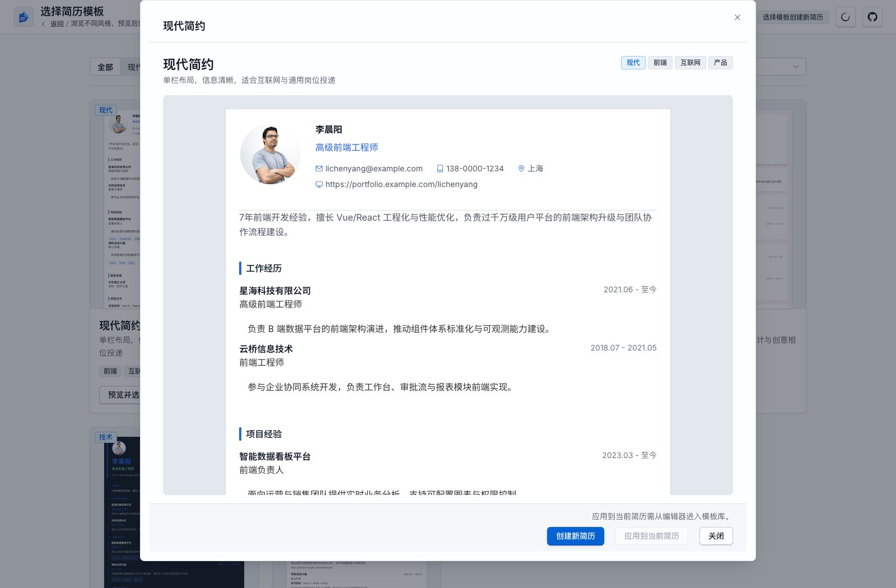
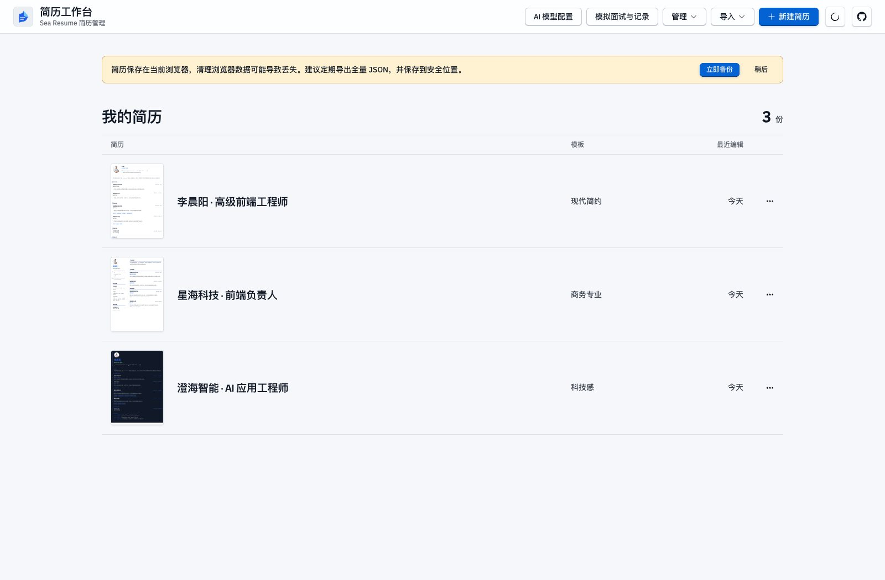
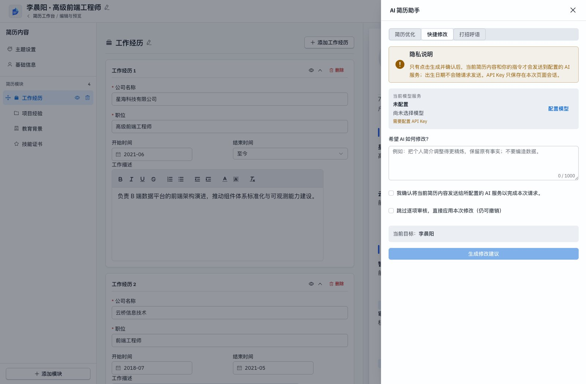
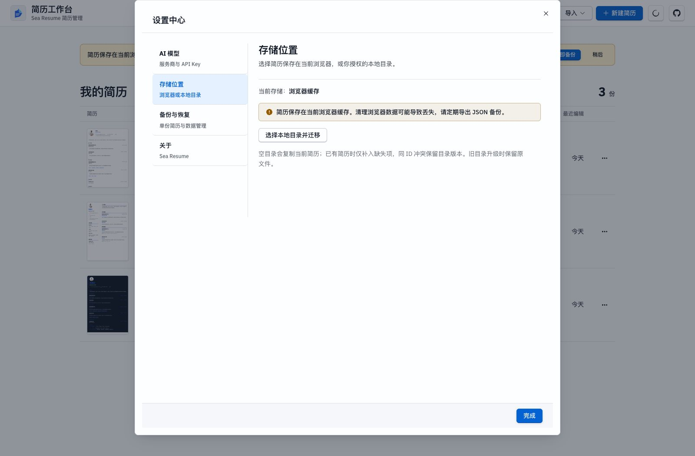

<div align="center">
  
  <h1>Sea Resume</h1>
  <p>中文简历制作工具 · 6 套模板 · 实时预览 · 岗位版本管理 · AI 辅助</p>
  <p>从整理经历到导出投递文件，在一个工作台里完成。</p>
  <p>
    <a href="https://blog.hypoy.cn/sea-resume/"><strong>在线体验 Sea Resume →</strong></a>
  </p>
  <p>
    <a href="https://linux.do/"></a>
  </p>
</div>

[](https://blog.hypoy.cn/sea-resume/)

Sea Resume 基于 Vue 3 与 TypeScript 构建，支持管理多份简历、按岗位创建独立版本、编辑内容与主题，并导入导出多种文件格式。界面可切换浅色、深色或跟随系统。基础编辑功能无需配置 AI 服务即可使用。

[界面预览](#界面预览) · [功能一览](#功能一览) · [快速开始](#快速开始) · [数据与存储](#数据与存储) · [开发与验证](#开发与验证)

## 界面预览

以下界面截图于 2026-11-11 截取，用于展示当前主要页面流程；功能细节以当前界面为准。

### 模板库：先看效果，再选风格

模板库支持按现代、商务、创意、极简、技术分类筛选，配合关键词搜索和排序查找模板。从当前简历存下的自定义模板会出现在 **我的** 分类。点击卡片上的 **预览并选择** 查看大图；从编辑器进入时，页面会提示 **当前简历可应用模板**。


| 模板 | 排版特点 | 适用场景 |
| --- | --- | --- |
| 现代简约 | 单栏布局，信息清晰 | 互联网与通用岗位 |
| 商务专业 | 双栏结构，排版稳重 | 金融、咨询与职能岗位 |
| 极简主义 | 纯净留白，阅读负担低 | 应届生与正式投递 |
| 创意设计 | 色块页眉与卡片分区 | 设计、品牌与创意岗位 |
| 科技感 | 深色纸面、等宽标题 | 开发、后端与算法岗位 |
| AI Agent 技术 | 紧凑单栏，突出 AI 工程与项目经历 | Agent、大模型应用与全栈研发岗位 |

点击预览弹窗底部的 **创建新简历** 新建一份简历，或点击 **应用到当前简历** 切换正在编辑的简历样式。编辑器 **更多 → 存为模板** 会把当前简历的内容、版式和主题保存成模板，只存在这台浏览器，不改动正在编辑的简历。自定义模板最多 20 个，可重命名或删除；删除后，已经用它创建的简历不受影响。



### 编辑器：三栏可调，右侧优先 A4

顶部提供 **AI 助手、撤销 / 重做、隐私打码、质量检查、全屏预览、模板选择、导入与导出**，头部下方是一条 **布局工具栏**。左侧 **模块导航**、中间编辑区、右侧 **预览区** 三栏宽度可拖动栏间分隔条调整（键盘方向键同样可用），双击分隔条或点击布局工具栏右侧的 **恢复默认布局** 回到默认；布局工具栏上三个带名称的开关可以随时显示或隐藏对应栏目，偏好按浏览器记住。右侧预览优先保持 A4 实际尺寸：空间不足时按「先收模块导航、再收编辑区」自动折叠，窗口变宽后自动恢复；手动拖拽或展开会临时让预览横向滚动。窄屏（1024px 及以下）改用 **编辑 / 预览** 切换视图。


### 章节管理：折叠内容，整理重点

**主题设置** 和 **基础信息** 可分别展开。下方 **模块排序与内容** 区域支持拖动章节排序、修改模块名称、显示或隐藏模块，以及展开或折叠章节。点击 **添加模块** 可添加已有模块或创建自定义模块。


### 主题设置：直接调整简历排版

通过色板或颜色选择器调整主题色，使用滑块修改字号、行高、模块边距和页面边距；还可选择日期格式、字体系列，并切换联系方式图标。

**A4 页面适配** 面板复用预览画布实测的页数（与破页线同一份测量），并提供 **尝试适配一页**。适配会逐档收紧模块边距、页面边距、行高与字号，只要回到一页就立即停止，不做多余压缩；全程不删除简历内容，字号不低于 12px。到下限仍超页时保留为多页，可还原原排版。适配按画布实测判断是否已回到一页。破页线就是导出 PDF / 图片的真实切页位置：切点只在内容之间的空隙里选，文字行不会被页缝切成两半；打印（浏览器打印对话框）仍按自己的排版分页，可能与画布相差一页。

新接手代码请先读 [架构与隐性契约](docs/architecture.md)：它记录了数据流、写入与保存时序的不变量，以及几处只有读注释才能发现的约定。


### 工作台：集中管理不同版本

为不同岗位维护独立简历，支持复制、重命名和删除；也可以从 Markdown 或已有 PDF 开始整理。**岗位版本与比较** 可查看版本历史、比较内容差异，并将选中的改动另存为新简历。主干的 **更多 → 存为新版本** 会延续同一条主干并递增版本号（卡片显示 `主干 v2`），由它派生的岗位版本若落后，会在版本历史里提示「主干已有新版」，并可 **同步主干**：列出主干多出来的内容、逐条勾选后另存为新版本，原岗位版本保留。



### AI 助手：按需求生成修改建议

可添加多个 AI 服务配置，使用 OpenAI、DeepSeek、通义千问、自定义 OpenAI-compatible 接口，或 Ollama / LM Studio 本机服务。模型服务只需在设置中心配置一次，各 AI 功能共用；本机服务可无 API Key，支持 JSON 兼容模式和超时设置；线上失败不自动切换服务。API Key 默认仅在页面内存，可按服务商勾选记住到本机。

助手分四个模式：**简历优化**、**STAR 润色**、**快捷修改**和 **打招呼语**。快捷修改按你的指令生成建议，审核后应用，也可以跳过逐项审核直接应用；最近一批 AI 修改可撤销。STAR 润色只重组你勾选的已有经历（情境、任务、行动、结果），不编造数字和结果，原文没有结果时不会补写。打招呼语可粘贴招聘要求，生成后可编辑再复制，不会改动简历。



### AI 求职闭环：优化简历，再练习面试

编辑器 **AI 助手 → 简历优化** 提供岗位分析、事实补充、自然表达改写与审查，逐条采纳并默认另存岗位版本。**模拟面试与记录** 支持文字训练 / 真实模拟、根据回答追问、报告与用户确认后的简历回补；报告可一键发起弱项专项练习，记录页提供本机训练概览与复发弱项统计，面试过程显示本地计时并（选择保存到本机后）保留未提交草稿。沿用纯前端与自带 API Key；同模型多角色不是独立事实核验，不提供所谓 AI 率检测。

详细流程、DeepSeek 式对话交互与有界 Loop / 项目深挖的设计边界见 [AI 求职助手](docs/ai-feature-design.md)。

### 外部 Agent 与本地 AI

编辑器 **更多 → 用文件交给外部 AI** 下载脱敏工作区并导入 JSON 草稿，确认后才保存。简历主页 **外部 AI** 的 MCP 桥接直接读写简历；面板为 Codex CLI、Claude Code、Pi、ZCode、DeepSeek Harness，以及 OpenCode、Gemini CLI、Qwen Code、Amp、Copilot CLI、Crush、Goose 生成接入命令。网站保持纯前端，relay 由站点托管；不使用 MCP 时无需安装。

配置、协议、安全边界和开源方案取舍见 [本地模型与外部 AI 接入](docs/local-and-external-ai.md)。

## 功能一览

| 能力 | 支持内容 |
| --- | --- |
| 简历管理 | 创建、复制、重命名、删除；创建岗位定制副本并记录公司 / 岗位及来源；主干版本号递增并提示派生版本是否落后 |
| 模板选择 | 六种内置模板、分类筛选、搜索、排序、预览与切换；可把当前简历存为本机模板 |
| 内容编辑 | 个人资料、自定义联系方式、富文本描述、工作经历、项目、教育、技能和自定义章节 |
| 章节管理 | 快速跳转、拖动排序、标题编辑、展开 / 折叠、显示 / 隐藏、添加 / 移除 |
| 编辑器布局 | 三栏宽度可拖动、单栏折叠隐藏、布局记忆；预览优先保持 A4 实际尺寸 |
| 版本比较 | 按章节查看新增、修改和删除；搜索与筛选差异，选择性采纳并另存为新简历 |
| 质量检查 | 确定性检查基础信息、内容完整度和可识别的日期范围异常，可跳转编辑 |
| 编辑恢复 | 自动保存、保存失败重试、撤销 / 重做及键盘快捷键 |
| 排版与预览 | 主题设置、A4 页数估算、一页适配、隐私打码、全屏预览及打印；界面支持浅色、深色与跟随系统 |
| 导出 | 与预览一致的 PDF、独立排版的可搜索 PDF、图片、JSON、Markdown；多页图片打包为 ZIP |
| 内容导入 | Markdown、JSON 副本；AI 辅助解析可复制文本的 PDF，并在创建前校对 |
| 数据与备份 | 浏览器或授权本地目录存储；单份与全量备份、校验及非覆盖恢复 |
| AI 能力 | 多服务商配置、模型列表读取、审核式简历修改、STAR 润色、打招呼语与 PDF 内容解析 |
| AI 求职闭环 | 三角色简历优化、文字训练 / 真实面试、动态追问、弱项专项练习、训练概览、报告与事实回补 |

## 快速开始

准备 Node.js 22.13+ 和 pnpm，在项目目录执行：

```sh
pnpm install
pnpm dev
```

打开终端输出的本地地址，默认是 `http://localhost:3000`；端口被占用时以实际输出为准。

1. 在工作台点击 **新建简历**，浏览并预览六种模板，或从 **我的** 分类选一份已保存的自定义模板，创建一份简历。
2. 在编辑器填写基础信息，逐步添加经历、项目、教育和技能；用章节快速跳转整理内容。
3. 使用 **质量检查** 查看待补充项目；修改内容后可撤销 / 重做，顶部会显示保存状态，失败时可重试。
4. 在 **主题设置** 查看 A4 页数估算，必要时尝试一页适配。导出时可选 **与预览一致的 PDF**（按预览渲染，文字不可搜索）、**可搜索 PDF**（依据简历数据独立排版）或打印预览。
5. 在工作台打开 **岗位版本与比较**，创建记录公司 / 岗位的独立副本；比较两份简历时可搜索和筛选变化，选择性采纳版本 B 的改动并另存为新简历。该操作不会修改原版本；模板、配色和排版不计入内容差异。
6. 使用工作台 **全量备份** 导出当前存储位置的全部简历。恢复前会列出 ID / 名称冲突；冲突项以新 ID 创建副本，不覆盖已有内容。单份 JSON 恢复同样会创建副本。
7. 需要 AI 辅助时，在工作台 **AI 模型配置** 添加线上服务并填写 API Key（可选勾选记住到本机），或选择 Ollama / LM Studio 本机无鉴权服务；编辑器助手、PDF 导入与模拟面试共用这份配置。面试确认步骤只展示已保存的服务 / 模型并记录同意。

已有内容可从工作台 **导入 Markdown** 或 **AI 导入 PDF** 开始。PDF 文本先在浏览器本地提取；可校对基础信息、经历、项目、教育和技能后创建新简历。仅在勾选同意并点击解析后，提取出的文本和文件名才会发送给所配置的 AI 服务。

## 数据与存储

工作台 **设置** 管理存储位置和单份简历备份；工作台顶部的 **全量备份** 可导出或恢复当前存储位置的所有简历。



- **浏览器存储**：默认将简历保存在当前浏览器中。清理站点数据可能导致简历丢失，建议定期使用全量备份并将文件保存在安全位置。
- **本地目录**：在工作台的 **设置** 中选择并授权目录。空目录会复制当前简历；已有 Sea Resume 数据的目录可增量合并，同 ID 冲突保留目录中的版本。该功能依赖浏览器的 File System Access API；入口是否可用以当前浏览器检测结果为准。授权失效时工作台会提示并可直接 **重新授权本地目录**，写盘超过 15 秒会明确报错而不是一直等待。
- **同步到网盘（推荐组合）**：把 **本地目录** 指向网盘客户端的同步文件夹（例如坚果云、OneDrive、iCloud 云盘），由客户端负责上传与多设备同步。Sea Resume 自身不保存网盘账号，也不直接访问网盘接口，因此不涉及密钥托管。以坚果云为例：在坚果云客户端里建一个同步文件夹，在本站 **设置 → 存储位置** 选择该文件夹并授权，此后每次编辑都会直接写入同步文件夹，由客户端自动上传；在另一台设备上用同样的方式选择该文件夹即可继续编辑。注意网盘客户端的同步有延迟，多设备同时编辑同一份简历仍可能冲突，建议一台设备编辑完成后再切换。
  - 为什么不做直接的 WebDAV 接入：坚果云的 WebDAV 接口不返回 CORS 响应头，而 Basic Auth 又会强制浏览器先发 OPTIONS 预检，纯前端页面无法直连。此外其免费版还有每 30 分钟 600 次请求的频率限制，逐份简历读写很容易触顶。通过网盘客户端同步文件夹可以同时绕开这两个限制。
- **单份 JSON 恢复**：导入后创建简历副本，不覆盖已有数据。
- **全量备份恢复**：备份带格式版本信息，恢复前先验证文件并显示待导入数量及 ID / 名称冲突；冲突项以新 ID 和独立名称创建副本，绝不覆盖现有简历。浏览器会在从未备份或距上次全量备份满 30 天时提醒；备份时间戳保存在当前浏览器。
- **PDF 导入**：最大 15 MB、最多 30 页，有两种识别方式。**文本提取**（默认）在浏览器本地读取文字层，并按版面还原分栏与表格顺序，不上传图片；**视觉识别**把页面在本机渲染成图片后发送给支持图片输入的多模态模型，可处理扫描件与复杂排版，单次最多 12 页。两种方式都只发送提取文本或渲染图片，原 PDF 文件本身不上传；勾选同意并确认后才会发起请求，确认创建前可校正识别内容。文字层为空时会提示切换到视觉识别。
- **AI 服务配置**：服务商、地址、模型与启用状态保存在当前浏览器。API Key 默认仅保存在页面会话内存，刷新或关闭页面后需重新输入；为某家服务商勾选「记住密钥到本机」后，密钥才会以明文写入本机浏览器存储，可随时取消勾选清除。配置文件与全量备份都不包含 API Key。
- **AI 请求**：仅在用户主动发起并确认的操作中向所配置的服务发送内容。出生日期不会随 AI 助手请求发送。
- **AI 工作记录**：选择保存到本机后才写入独立浏览器数据库，不含 API Key、不随简历目录迁移，也不纳入全量简历备份；支持面试 JSON / Markdown 导出和记录删除。新优化 / 面试默认排除隐藏内容及结构化联系方式，正文中的敏感信息仍需发送前检查。面试未提交草稿只在选择保存到本机时暂存于当前浏览器，切回仅内存会立即清除。
- **自定义模板**：保存在当前浏览器，不随简历目录迁移，也不纳入全量备份。清理站点数据会一并删除这些模板。
- **外部 AI**：默认关闭，仅授权当前可见正文；不共享结构化身份／联系方式、头像、隐藏条目或面试历史。正文中的隐私需人工检查。授权30分钟，关闭面板或刷新即撤销；CLI 本机运行不等于模型离线。

## 开发与验证

| 命令 | 用途 |
| --- | --- |
| `pnpm dev` | 启动 Vite 开发服务器 |
| `pnpm build` | 执行 Vue / TypeScript 类型检查并构建生产资源 |
| `pnpm preview` | 本地预览生产构建 |
| `pnpm test` | 执行 Vitest 测试 |
| `pnpm test:watch` | 以监听模式运行测试 |
| `pnpm verify` | 依次运行完整测试、类型检查和生产构建 |

新功能从 `dev` 切出功能分支，用 Pull Request 合入；`master` 是可发布主分支，只接受来自 `dev` 的发布 PR。合入后用 `node tools/release-tag.mjs vX.Y.Z` 打附注标签，版本号与 `CHANGELOG.md` 同源，界面「设置 → 关于」显示构建时的版本。分支、提交信息、版本规则与发版步骤见 [贡献规范](CONTRIBUTING.md)，历次变更见 [更新日志](CHANGELOG.md)。

```sh
pnpm build
pnpm test
```

技术栈：**Vue 3、TypeScript、Pinia、Vue Router、Element Plus、Tailwind CSS、SCSS、Vite（rolldown-vite）、Vitest**。与预览一致的 PDF 和图片导出使用 html2canvas / jsPDF；可搜索 PDF 使用 pdfmake；PDF 文本提取使用 PDF.js；多页图片归档与外部 AI 工作区使用 fflate。可搜索 PDF 使用项目内置的 Noto Sans SC 字体。

```text
src/
├── views/                 # 工作台、模板库、编辑器
├── components/            # 内容编辑、模板预览与通用组件
├── stores/                # 简历、模板、工作台与存储状态
├── services/ai/           # AI 服务、配置、PDF 导入与外部 AI
├── services/storage/      # 浏览器与本地文件系统存储
├── services/templates/    # 本机自定义模板
├── utils/                 # 导出、备份与通用数据处理
│   ├── markdown/          # Markdown 导入、导出与安全转换
│   └── pdf/               # 可搜索 PDF 定义与模板排版
└── types/                 # 简历、存储与 AI 类型定义
docs/
├── images/                # README 界面截图
└── ui-guidelines.md       # 应用界面样式与交互约定
```

生产构建输出到 `dist/`。项目使用 Vue Router 的 history 模式，部署到静态服务器时需将应用路由回退到 `index.html`，保证刷新编辑器和模板库页面时正常加载。

## 样式与交互约定

全站界面 token、头部、表单、弹层、危险操作和响应式规范见 [UI 设计与交互规范](docs/ui-guidelines.md)。应用界面与六种 A4 简历模板分别维护；模板排版和用户主题由各模板及简历数据负责，不套用应用界面的全局重置。
