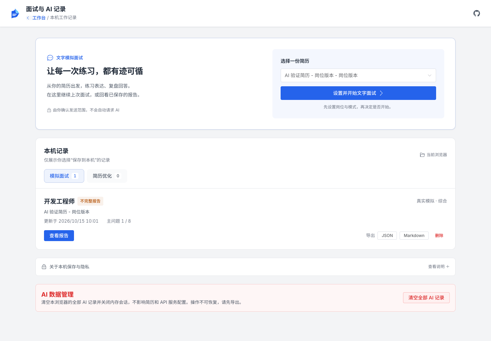

# AI 求职助手

## 产品边界

纯前端运行，用户自带 OpenAI-compatible API Key，不新增服务器、账号、代理或外部工具。API Key 只在当前页面内存中；刷新后需要重新配置。默认一个模型按角色工作，多角色审查不等于独立事实核验。

目标是“把真实经历讲清楚，并练习讲明白”，不是生成虚构成果或保证录用。

## 简历优化

编辑器打开 **AI 助手 → 简历优化**，已有 **快捷修改** 保留。

1. 填写岗位、可选公司 / JD，选择“简洁直接”或“专业克制”，可提供个人表达样例。
2. 查看发送预览和服务配置，确认后分析。岗位与简历分析角色提出匹配点、缺口及最多三条事实问题。
3. 填写事实或跳过。内容编辑角色只改写已有事实；没有数字就不编数字。
4. 内容审查角色执行一轮检查，建议分为通过、待确认、拒绝。待确认项需明确确认，拒绝项不能应用。
5. 比较原文与建议，逐条勾选。默认另存岗位副本；明确选择后才更新当前简历，可通过编辑器历史撤销。

采纳前检查目标字段是否已变化，冲突不能静默覆盖。新增经历 / 项目仍由用户手动添加，不开放模型自由增删权限。无修改建议也是正常结果。

### 自然表达，而非“AI 率”检测

减少空泛词、重复句式、关键词堆砌和个人贡献夸大，保留专业名词。不提供 AI 百分比，不承诺绕过检测。同模型审查仍需要用户确认真实性。

## 文字模拟面试

从编辑器、工作台简历卡片菜单或 **模拟面试与记录** 开始。选择简历、目标岗位、可选 JD、目标级别，以及综合 / 项目深挖 / 岗位专业 / 行为面试。

- 主问题可选五、八、十二道；每道主问题最多一次追问，边界由代码控制。
- 开始时固定本次发送的简历快照。之后修改原简历不会改变本次上下文。
- 每次一道题，面试官根据实际回答决定追问或继续，不会自动替候选人回答。
- **训练模式**：答后看教练点评，再继续。教练提示不会被当成候选人答案送给面试官。
- **真实模拟模式**：过程中不调用教练，结束后统一报告。
- 可回答“不知道”、跳过、暂停或提前结束。未完成时报告标记不完整，不给录用概率。

反馈区分表达不足与知识缺口，引用回答并说明可核验边界。不评价文字场景无法观察的语速、肢体表现。知识讲解和参考表达不等于用户真实经历。

## 面试回补

报告中的补充事实必须来自实际提交的回答。用户确认事实、选择关联的已有经历 / 项目后，再进入简历优化和审查。教练的参考答案不能成为事实；知识缺口不能直接变成简历技能。最终仍需逐条采纳，默认新版本。

## DeepSeek、Loop Agent 与 Deep Agent

借鉴对话产品的清晰问答、可展开结论摘要、重试和继续交互，不复制品牌，不保存 / 展示模型内部思维链。

这里的 **Loop Agent** 指有限的“回答 → 判断追问 → 再回答”状态循环；**项目深挖** 借鉴 Deep Agent 的逐层分析思路，围绕个人职责、技术选择、验证与边界提问。它们不是特定框架集成，不代表联网搜索、无人监督执行或无限循环。

优化采用固定三角色流水线，不进行无限 Agent 辩论。重试是用户主动操作，只重试失败阶段，可能再次收费。

## 隐私与记录

- 新优化和面试只发送白名单中的可见内容；隐藏章节 / 条目默认排除。
- 结构化姓名、生日、照片、电话、邮箱、自定义联系方式及主题排版不发送。公司 / 学校可泛化；正文、JD、回答仍可能含敏感信息，发送前请检查。
- 只有用户选择“保存到本机”才将 AI 工作记录写入独立 IndexedDB，否则仅保留在本次会话。
- AI 记录不包含 API Key，不随简历目录迁移，也不属于全量简历备份。清理浏览器数据会丢失记录。
- 恢复不会自动重发中断的付费请求；需重新提供会话密钥、确认发送并手动继续。
- 支持面试 JSON / Markdown 导出、单条删除与清空 AI 记录；不支持导入或跨设备同步。

## 界面与操作

- 记录页分为开始练习、分类记录和数据管理；无记录时提供引导，清空操作不占据主操作位。
- 桌面端以问答为主、辅助信息为侧栏；手机端改为单栏。报告生成后优先展示报告，历史问答可展开。
- 面试官、个人原回答、教练反馈分区显示。点击“继续”后可定位新题，也可使用“定位当前题”返回。
- 普通 Enter 换行，Ctrl / ⌘ + Enter 提交；中文输入法组词期间不会误提交。暂停保留未提交草稿（不代表已持久化，刷新仍可能丢失）。
- 删除、结束和离开确认使用站内弹窗，支持取消；浏览器关闭 / 刷新的未保存警告仍由浏览器处理。

下列截图使用虚构简历和 mock 响应，不含真实个人信息或 API Key：

[手机记录页](images/ai-records-mobile.png) · [面试问答页](images/ai-conversation-desktop.png) · [手机端删除确认](images/ai-record-delete-mobile.png)

## 模型与费用

兼容 OpenAI、DeepSeek、通义千问及自定义服务。默认要求 JSON 输出；明确遇到不支持 `response_format` 的错误后，可选择兼容模式手动重试，返回结构仍严格校验。

通常优化流程三个调用；训练答后点评增加调用，真实模式不做中途点评。显示可获得的调用与 token 使用信息，不在未知服务价格时估算人民币费用。校验失败的响应也可能已收费。

浏览器直连受服务商 CORS 限制，无法连接时请检查服务是否允许当前来源。系统不提供绕过限制的公共代理。

## 验证

自动化测试使用可控 mock，不调用真实模型、不写入密钥。测试关注隐私筛选、输出与来源验证、状态边界、取消 / 重试、模式隔离、冲突采纳和恢复。

真实模型的内容质量、具体服务商跨域配置及额度需要使用用户自己的会话配置联调；自动化测试通过不等于模型输出始终正确。
